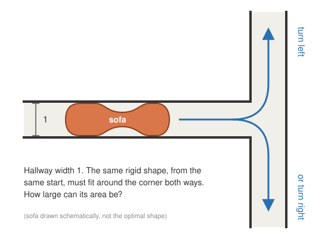
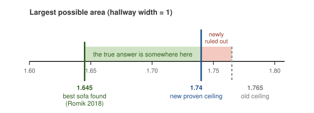

# Ambidextrous moving sofa: area ≤ 1.74

A computer-assisted proof that **every ambidextrous sofa has area at most 1.74**. The previous best upper bound was 1.765.

## In plain words

<p align="center"></p>

- **The hallway.** Take a hallway exactly 1 unit wide (say 1 metre) with a 90° corner at the end.
- **The sofa.** It is any flat, rigid shape that you slide along the floor. You may rotate it and wiggle it, but you may not lift or bend it.
- **Ambidextrous.** The *same* shape, from the *same* starting spot, must be able to get around the corner whether it turns left or right.
- **The question.** What is the largest area such a shape can have? With a 1 m hallway, the area is in m².

<p align="center"></p>

- **1.645**: someone found a specific shape this big that works, so the answer is *at least* 1.645.
- **1.74**: this repo proves that *no* shape larger than this can work, whatever its form, so the answer is *at most* 1.74.
- **Unknown**: the true answer lies somewhere in between, and nobody knows where. Before this work, the proven ceiling was 1.765.

This result did not find a better sofa. It proves that bigger sofas are impossible. For comparison, a 1×1 square fits around the corner both ways, so the answer is at least 1. The ordinary one-way version of the problem (the classic moving sofa problem) was settled only recently, after about 60 years: its answer is ≈ 2.2195.

## The numbers

| | Value | Source |
|---|---|---|
| Lower bound | 1.64495521… | Romik (2018) |
| Previous upper bound | 1.765 | [devinokeefe/ambidextrous-sofa-bounds](https://github.com/devinokeefe/ambidextrous-sofa-bounds) |
| **New upper bound** | **1.74** | this repo |

An *ambidextrous sofa* is a connected planar shape that can move through a unit-width hallway with a right-angled corner, turning either left or right, from the same starting position. Its largest possible area μ_A is unknown. The problem is listed as 6.63 in Georgiev, Gómez-Serrano, Tao and Wagner, *Mathematical exploration and discovery at scale*.

> **Status:** not peer reviewed, and not formalised in Lean. Please treat it as a claim to check. Issues and corrections are welcome.

## What is new

This work builds directly on *Upper bounds for the ambidextrous moving sofa problem*, abbreviated below as the **paper**: [devinokeefe/ambidextrous-sofa-bounds](https://github.com/devinokeefe/ambidextrous-sofa-bounds). It uses the same pieces:

- **The relaxation.** The paper bounds the Kallus–Romik relaxation G(A;B) with A = B = {arcsin 3/5, arcsin 4/5}.
- **The search.** The parameter space is bisected into boxes, and every leaf box E must satisfy Γ(E) ≤ T. Here Γ(E) is the largest connected area of the union of the hallways over the box.
- **The reductions.** The paper's thm:reduction2 and thm:reductionZ turn a bound on G(A;B) into a bound on μ_A. Their hypotheses hold for T = 1.74: sin δ_T = 100/174 < 3/5, so both angles lie in [δ_T, γ_T] = [35.08°, 54.92°].

The paper notes that Γ becomes very expensive as T approaches the relaxation's own value, which is at least 1.7317. Its certificate for 1.765 needed 872M nodes.

### The telescoping bound

This repo adds a second test that a leaf box can pass instead of Γ.

Γ widens every hallway strip on *both* edges by the box width. Near the optimum, though, the area is stationary: a shift gains on one edge roughly what it loses on the other. The new bound uses that. Let c be the centre of the box E. Move from c to any w ∈ E one coordinate at a time, and add up the worst net change of each step:

```
sup_{w∈E} λ*(B_W ∩ X(w))  ≤  area(B_W ∩ X(c))  +  Σ_coords max_dir max_k [ gain_U(t_{k+1}) − loss_C(t_k) ]
```

- Gains are measured in U, the union over the box, which contains every X(w).
- Losses are measured only in C, the *cores* of the other hallways. A core is the set of points that lie in the hallway for every parameter in the box, so these losses are guaranteed.
- Each half-width is cut into n = 8 sub-slabs.
- The bound requires box half-width ≤ 1.
- The exact definition of each slab and the proof are in the header comment of the patched `checkers/cchk.c`, above `the telescoping bound`.

Effect on certificate size (nodes), with A = B = {3/5, 4/5}:

| T | Γ only | Γ + telescoping |
|---|---|---|
| 1.85 | 5.09M | 2.32M |
| 1.80 | 41.2M | 6.56M |
| 1.77 | 475M | 17.6M |
| 1.74 | ~290B (extrapolated) | **165M** |

The node count grows like about gap^-1.8 instead of gap^-4.2, where gap = T − 1.7317. The 1.74 search took 62 minutes on a 16-thread M4 Max laptop.

## Verification

- **Exact C checker.** This is the paper's `cchk.c`, which does exact 128/256-bit integer arithmetic with overflow checks, plus the telescoping test as a second leaf test (about 230 added lines). Result: `CERTIFICATE VALID`. There are 82,714,097 leaves, 76,434,160 of them certified by the telescoping bound. See `logs/check_v174.log`.
- **Independent Python check.** `tools/sample_check.py` re-implements the telescoping bound separately in exact `Fraction` arithmetic and reuses the paper's Python Γ code. All 2,398 randomly sampled leaves pass. See `logs/pycheck_v174.log`.
- **Sanity check.** Without the telescoping test, the checker rejects the certificate.
- **Soundness fuzzing (floating point).** 72k random boxes plus 12k boxes chosen by a hill-climbing adversary never found an area above the bound.

What you have to trust beyond the paper is the telescoping lemma and the patch to the checker.

## Reproduce

```sh
git clone https://github.com/devinokeefe/ambidextrous-sofa-bounds up
cd up && git checkout 4375343b1cb773f3f46623dad84a20adeef799a8
git apply ../patches/telescoping.patch

# build (macOS: brew install libomp; with gcc on Linux use plain -fopenmp)
OMP=$(brew --prefix libomp)
clang -O3 -Xpreprocessor -fopenmp -I$OMP/include -I checkers/portable -L$OMP/lib -lomp checkers/cchk.c -o cchk
clang -O3 -Xpreprocessor -fopenmp -I$OMP/include -L$OMP/lib -lomp search/csearch.c -o search/csearch -lm

# check the certificate (about 17 min on 16 threads)
cp ../data/specs/v174.json data/specs/
zstd -d ../data/certs/cert_v174.txt.zst -o data/certs/cert_v174.txt
(cd data && shasum -a 256 -c ../../data/certs/cert_v174.sha256)
cd data && ../cchk specs/v174.json 16 20

# independent sampled check
python3 ../../tools/sample_check.py specs/v174.json certs/cert_v174.txt 0.00003 7 ../checkers

# regenerate the certificate (about 1 h on 16 threads)
OMP_NUM_THREADS=16 PRESPLIT=65536 python3 ../search/run_search.py 3/5,4/5 3/5,4/5 174/100 v174 -c 16 -b 1 -m 8 -g 10
# then add "nsub": "8" to specs/v174.json
```

`patches/telescoping.patch` changes three files of the paper's repository:

- `checkers/cchk.c`: adds the telescoping leaf test, enabled by the spec key `"nsub"`.
- `search/csearch.c`: adds the telescoping bound to the search (options `-b 1 -m 8 -g 10`).
- `search/run_search.py`: adds the `CSEARCH` and `PRESPLIT` environment overrides.

## Credits

All the mathematics apart from the telescoping bound comes from the paper and the work it builds on: Kallus–Romik, Romik, and the paper's own author.

The telescoping bound, the search and the verification were done by an AI agent (Claude, by Anthropic), directed by [@larskarbo](https://github.com/larskarbo).
